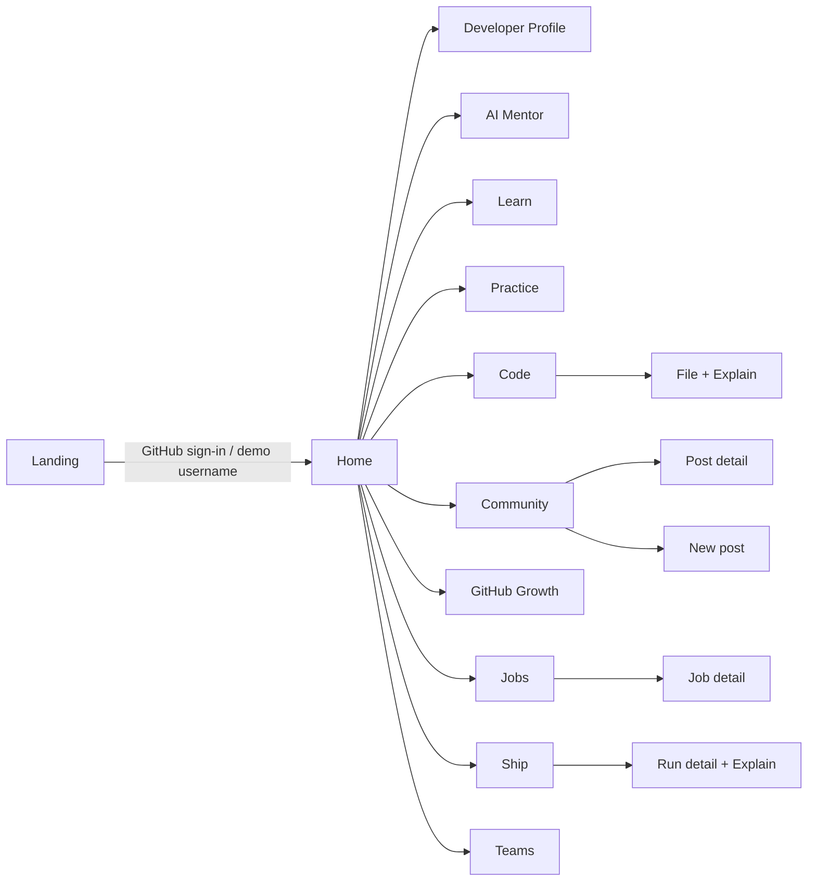
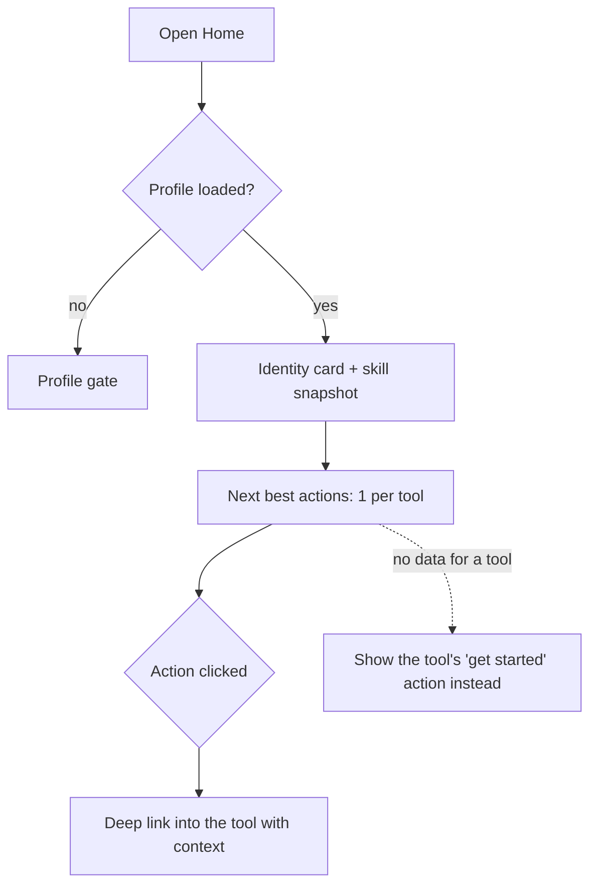
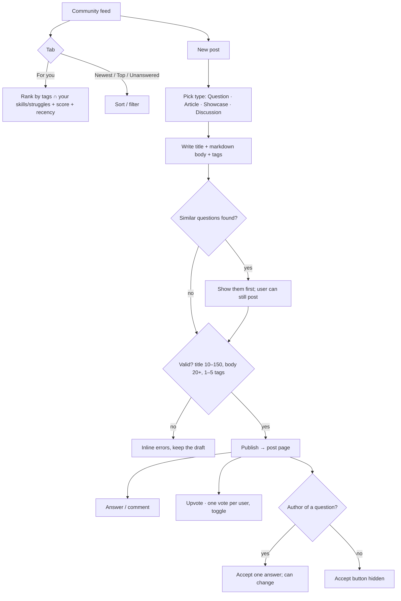
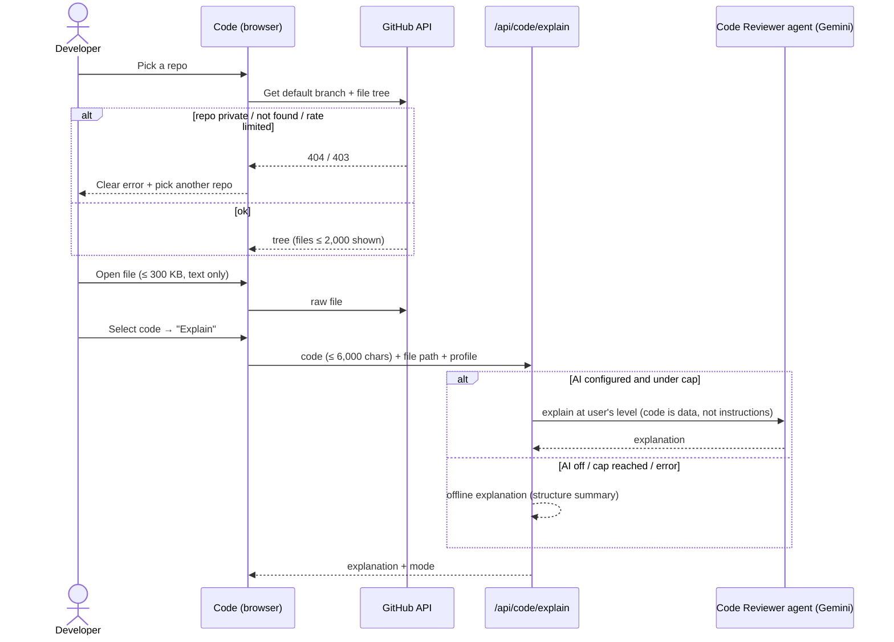
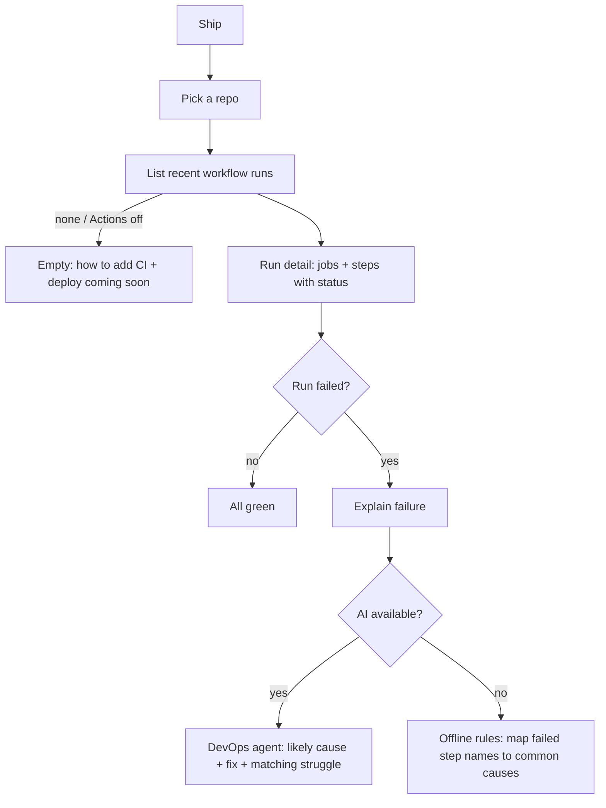
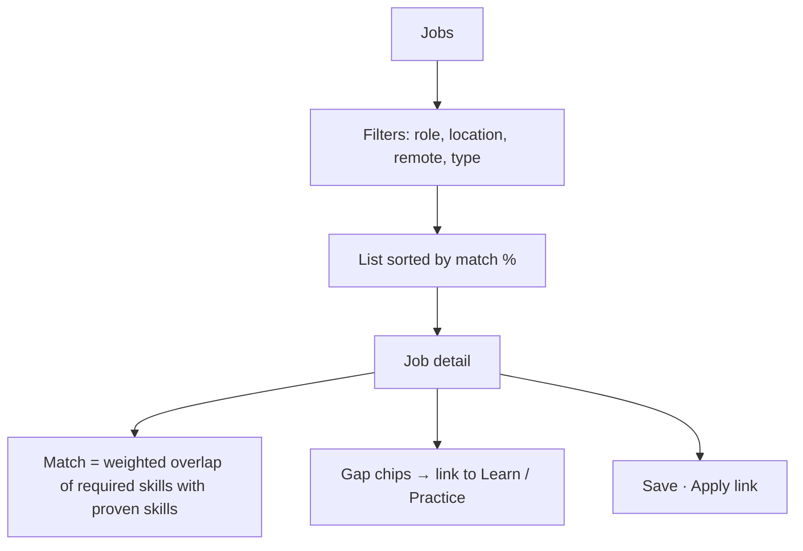

# 09 — UX, Screens and Flows

> Status: **v1 (front end)** · Written 2026-11-13 for the "all blocks" build. Front end first; the backend for
> Community, Jobs and Teams is planned in `10-backend-plan.md` and decided together before it is built.
> Diagrams are Mermaid (render on GitHub / VS Code).

## 1. Design principle: familiar, not copied (D-15, amended by D-33)

Every DevVerse tool replaces an app developers already know. Each screen uses that app's **layout pattern**
(where things are, how you act) and, since D-33, may also echo its **look and conventions** (density, terminology,
reading typography, difficulty colours), so people switching over feel at home. Limits: no logos, names, trademarks,
exact brand palettes or proprietary fonts, and no copied code, CSS, images or text. The shell, tokens and the
anti-vibecode rules (`12` §2) stay DevVerse's own. Everything also gains one thing the original can't do: **it knows your profile**.

| DevVerse tool | Familiar pattern borrowed from | What we keep | What we add / change |
|---------------|-------------------------------|--------------|----------------------|
| Home | GitHub home, LinkedIn feed | Left identity card, centre activity, right suggestions | Every suggestion comes from your profile, one per tool |
| Practice | LeetCode | Problem table (status, number, title, topics, easy / medium / hard colours), workspace with Description / Hints / Submissions tabs, editor with Testcase / Test Result console, Run vs Submit, prev / next; state in the URL (`?problem=`) | Coach hints instead of solutions; "why this problem" |
| Community | Stack Overflow + Medium / Substack + dev.to | Vote column, accepted answer, tags, Q&A thread; articles in a 680 px serif reading column (Source Serif 4) with byline, read time and a clap / responses / copy-link bar; tabs and type filter in the URL | "For you" tab ranked by your struggles; one feed for 4 post types; similar-question check while writing |
| Code | VS Code / github.dev | Activity bar, file tree, tabs, editor, side panel | "Explain this" panel by the Code Reviewer agent, at your level |
| Ship | GitHub Actions + Vercel | Runs list with status dots, run detail with steps | DevOps agent explains why a run failed in plain words |
| Jobs | LinkedIn Jobs + Wellfound | Filters, job list, job detail side by side, save | Match % from proven skills + your gap per job |
| Teams | GitHub org + Linear | Members list, team overview | Team skill matrix, onboarding path per new member |
| AI Mentor | ChatGPT / Gemini app | Chat with streaming answers | Knows your history |

No real-time chat (D-05): Discord's role is covered by Community discussions.

## 2. Information architecture



Sidebar order: Home · Profile · AI Mentor · Learn · Practice · Code · Community · GitHub Growth · Jobs · Ship · Teams.

## 3. States every screen must handle

| State | What the user sees |
|-------|--------------------|
| No profile yet | Profile gate: sign in, or "try with any GitHub username" (D-18) |
| Loading | Skeleton or spinner with what is happening ("Reading your repos…") |
| Empty | One-line explanation + the next action (never a blank panel) |
| Error | What happened + what to do (NFR-UX-05), retry button |
| AI unavailable / daily cap | Offline answer or authored fallback, labelled "(offline)" (NFR-AV-03) |
| Demo mode | Banner: data is public-only and kept in this browser |
| Sample content | Badge "Sample" on any seeded content (Community, Jobs, Teams) until the backend is live |
| GitHub rate limit | "GitHub is limiting requests; try again in a few minutes" + cached data if any |

## 4. Flows with exception paths

### 4.1 Home (overview)



### 4.2 Community — ask, answer, accept, vote



Exceptions: empty feed (no posts for your tags → show Newest); offline / storage blocked (posts kept in memory,
warning shown); post not found (404 card + back link); self-voting blocked; markdown is rendered safely (no HTML).

### 4.3 Code — open repo, read, explain (Code Reviewer agent)



Exceptions: binary / huge files show "preview not available"; empty selection explains the whole file (first 6,000
chars); edits are local drafts only — nothing is ever pushed (rule 1).

### 4.4 Ship — CI runs and failure explanation (DevOps & Debug agent)



### 4.5 Jobs — match and gap



Exceptions: no matches (show closest roles + biggest gaps); job closed (badge, apply hidden).

### 4.6 Teams — skill matrix and onboarding

```mermaid
flowchart TD
  A[Teams] --> B{Has team?}
  B -- no --> C[Create team (sample team until backend)]
  B -- yes --> D[Members + skill matrix heatmap]
  D --> E[Team strengths / bus-factor risks]
  D --> F[Onboarding path for a member: team stack − member skills]
  D --> G[Codebase agent (Enterprise, coming soon)]
```

## 5. Swimlane: one request through the agent team (target, D-28)

```mermaid
sequenceDiagram
  actor U as Developer
  participant O as Orchestrator
  participant P as Profile (memory)
  participant A as Specialist agent
  participant T as Tool (GitHub / judge / deploy)
  U->>O: request
  O->>P: read profile summary
  O->>A: route with context
  A->>T: tool call (read-only unless approved)
  T-->>A: result
  A-->>O: answer + evidence facts
  O->>P: write evidence (never transcripts)
  O-->>U: merged answer; asks before any change (AG-04)
```
