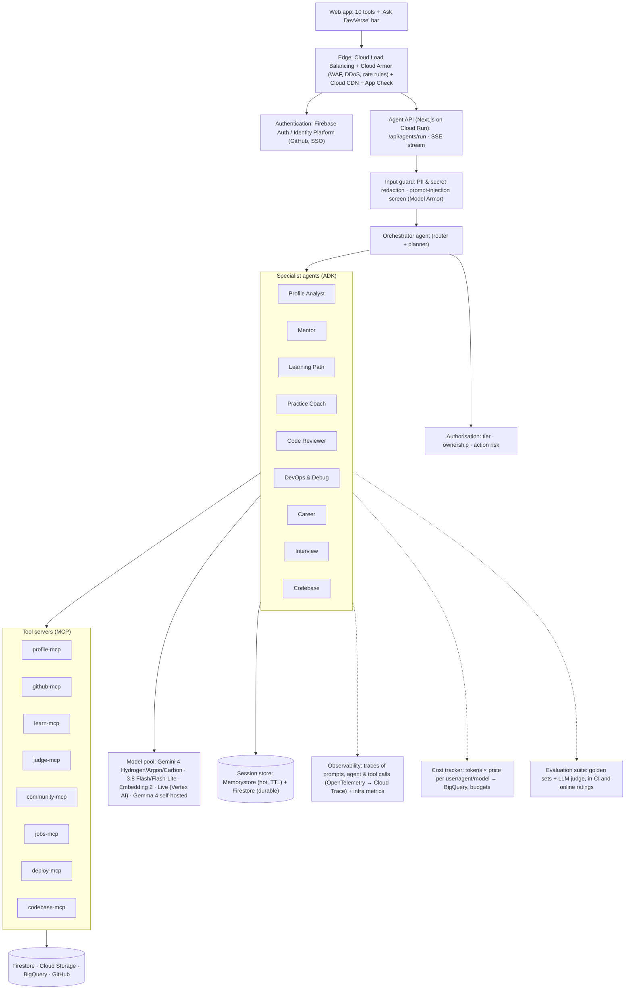
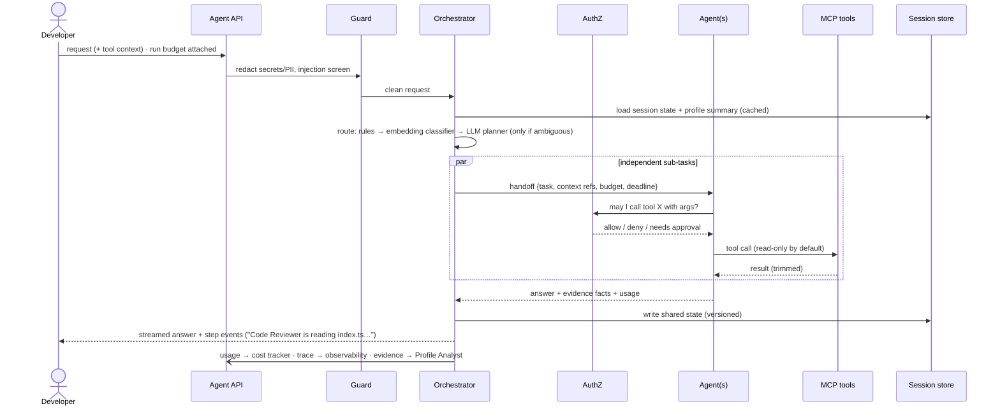

# 11 — Agentic System Architecture (multi-agent, multi-model)

> Status: **Design v1**, 2026-11-13. Implements D-28 (orchestrator + 9 agents). Adapted from a production
> banking agent reference (edge security → coordinator → domain agents → MCP tool servers, with authorisation,
> PII redaction, evaluation, model pool, session store, observability and cost tracking), reshaped for a
> developer platform. Build order: §12. To-do list: `12-todo.md`.

## 1. Goals (in priority order)

1. **Safe**: an agent can never leak another user's data or secrets, or change code/deploy without approval (AG-04).
2. **Fast**: first visible token < 1.5 s for single-agent requests, < 3 s for multi-agent (NFR-PF-05 tightened).
3. **Cheap**: average AI cost per active user per month stays well below 10% of the Pro price (D-29).
4. **Reliable**: every request returns something useful, even with every model down (NFR-AV-03).
5. **Consistent**: one source of truth for the Developer Profile; agents never write it directly.

## 2. Architecture

## 3. Mapping from the reference design

| Reference component | DevVerse version | Why it changes |
|---------------------|------------------|----------------|
| Chat UI | Every tool + a global "Ask DevVerse" bar | Agents are embedded in tools, not only in chat |
| Edge layer | Cloud LB + Cloud Armor + CDN + App Check | Google-native; App Check blocks scripted abuse of free AI |
| Bank identity provider | Firebase Auth (GitHub) / Identity Platform (SSO) | Developers sign in with GitHub; enterprises with SSO |
| Coordinator agent | Orchestrator: deterministic router first, LLM planner only when needed | Most requests map to one tool → no LLM hop (latency, cost) |
| Accounts / Transaction / Service agents | 9 specialist agents (D-28) | One per AI job in the platform |
| MCP servers | 8 tool servers | Same pattern; also usable by Antigravity / Gemini CLI |
| Authorisation | Policy per tool call: plan tier, resource ownership, risk class | Writes (push, deploy, post) always need user approval |
| PII redaction | PII + **secret** redaction (API keys, tokens in code and CI logs) | Developer content leaks secrets more than PII |
| Agent evaluation suite | Golden sets per agent + LLM-as-judge (Gemini Pro-class) + online thumbs | Gate prompt/model changes (NFR-AI-07) |
| Self-hosted + third-party LLM | Gemma 4 on GKE (private, Enterprise, cheap classification) + Gemini on Vertex AI | Data residency for Enterprise, cost for bulk |
| Session store | Memorystore (Redis) hot state + Firestore durable summaries | Fast inter-agent state; durable memory = the profile |
| Observability, Cost tracker | Same, plus per-tier budgets that change model routing | Cost control is a product feature, not just a dashboard |

## 4. Request lifecycle (one run)

Run states: `queued → routing → running → awaiting_approval → done | failed | degraded`. Every run has an id;
the UI shows live step events over SSE.

## 5. Orchestration design

- **Three routing tiers** (cheapest first): (1) **tool context** — a request from the Code tool goes to the Code Reviewer, 0 ms; (2) **keyword + embedding intent classifier** over agent descriptions (Embedding 2, cached vectors), ~20 ms; (3) **LLM planner** (Hydrogen, JSON plan) only when confidence < threshold or the request spans tools.
- **Patterns**: single dispatch (default, ~90% of traffic); **parallel fan-out + aggregator** for cross-tool questions ("am I ready for this job?" → Career ∥ Profile Analyst ∥ Practice Coach → merge); **planner-executor** for multi-step tasks (AI-12) with the plan shown for approval.
- **Handoff contract** (A2A-style): `{ runId, task, contextRefs[], constraints, budget: {tokens, toolCalls, deadlineMs}, depth }`. Agents pass **references** (profile version, file path + line range, run id), not copies of data.
- **Hard limits**: max depth 2, max 3 agents per run, max 8 tool calls per agent, deadline 20 s; exceeded → return best partial answer marked `degraded`.
- **Agents are stateless**; all state lives in the session store keyed by `runId` / `sessionId`.

## 6. Latency

| Technique | Effect |
|-----------|--------|
| Stream first token; send step events immediately | Perceived latency < 1 s |
| Skip LLM routing via tool context / classifier | Saves one model round trip (300–800 ms) |
| Parallel fan-out with per-agent timeouts | Multi-agent ≈ slowest agent, not the sum |
| Region **asia-south1** (Mumbai) for app, Firestore, Vertex, Memorystore | Lowest RTT for Indian users; same-region hops |
| Profile summary pre-computed and cached (Memorystore, keyed by profile version) | No profile build on the hot path |
| Gemini context caching for long system prompts + profile | Lower time-to-first-token on repeat calls |
| `minInstances: 1` in production, HTTP keep-alive, connection reuse | No cold starts on the agent API |
| GitHub responses cached with ETags | Fewer, faster tool calls; respects rate limits |

## 7. Cost & token optimisation

1. **Model tiering by agent and by plan**: Flash-Lite for classification/tagging, Flash/Hydrogen default, Argon for code review/CI, Carbon only for premium deep analysis; Free tier is capped to Flash.
2. **Compact context**: profile **summary ≤ 300 tokens** (never the full profile); code selections ≤ 6k chars; CI logs → last 200 lines after secret redaction; retrieval top-k = 5.
3. **Output caps** per agent (hints ≤ 120 tokens, explanations ≤ 400) and JSON schemas where possible.
4. **Semantic cache**: hash(normalised question, agent, profile version) → answer for 24 h; embedding-similar hits ≥ 0.95 reuse answers for generic questions.
5. **Context caching** for shared prefixes (system prompt + tool schemas).
6. **Batch API** for nightly profile re-wording and roadmap refreshes (non-interactive, cheaper).
7. **Don't fan out** unless the classifier says the request spans tools.
8. **Budgets**: per-user daily token budget by tier; when 80% used, route to cheaper models; at 100%, offline answers (already in place).
9. **Cost tracker** writes `{runId, user, tier, agent, model, inTokens, outTokens, cachedTokens, $}` to BigQuery; Looker Studio dashboard; alerts on cost per active user.

## 8. Reliability & availability

- **Fallback chain per agent**: primary model → secondary model → Flash-Lite → **offline rules** (`callAgent`, in place today).
- **Circuit breaker** per model/provider (open after 5 failures/30 s; half-open probe).
- **Retries** with exponential backoff + jitter, only for idempotent reads; tool writes carry **idempotency keys**.
- **Timeouts everywhere** (model 15 s, tool 5 s, run 20 s) → `degraded` partial answers, never a spinner forever.
- **Async work** (imports, indexing, evaluations) via Cloud Tasks / Pub/Sub with dead-letter topics.
- **Stateless Cloud Run** across zones; Firestore multi-zone; Memorystore standard tier (replica); **read-only mode** switch if writes fail.
- **SLOs**: agent API availability 99.5%, p95 first token 1.5 s / 3 s; error budget alerts in Cloud Monitoring.

## 9. Consistency

- **Single writer**: agents emit evidence events; only the Profile Analyst updates the profile (event-sourced, append-only evidence).
- **Versioned reads**: each run pins `profileVersion`; all agents in the run see the same snapshot.
- **Session state** uses optimistic concurrency (version field, retry on conflict); shared state keys are namespaced per agent.
- **Votes, accepts, counters**: Firestore transactions / sharded counters.
- **Exactly-once effects** for writes via idempotency keys; reads may be retried freely.

## 10. Security & safety (agent-specific)

- **Least-privilege tools**: each agent has an allowlist of MCP tools; write tools exist only behind approval.
- **Untrusted content** (repo files, CI logs, posts, job text) is wrapped as data with markers, never concatenated into instructions; injection screen on inputs, output filter on answers.
- **Secret redaction** before any model call (regex for keys/tokens + Cloud DLP / Model Armor), and secrets never stored in session state.
- **Per-tenant isolation** for Enterprise: separate vector index and storage per team; Gemma 4 option for no data leaving the VPC.
- **Audit log** of every tool call with run id, user, tool, decision.

## 11. Evaluation

Golden sets per agent (hints that must not leak solutions, CI failures with known causes, code explanations,
roadmaps), scored by rules + an LLM judge; run in CI on every prompt/model change and nightly on samples of
production traffic (redacted). Online signals: thumbs ratings (AI-10), "solved after hint", "fix worked".
A change ships only if it doesn't regress quality and keeps cost/latency within budget.

## 12. Build phases

| Phase | Delivers |
|-------|----------|
| A1 | Agent registry (`lib/agents/registry.ts`: name, tools, model, budgets, prompts) + shared `callAgent` gets budgets, timeouts, usage capture |
| A2 | Secret/PII redaction guard + injection screen on every agent input |
| A3 | Agent API `/api/agents/run` with SSE step events; "Ask DevVerse" bar in the UI |
| A4 | Orchestrator routing tiers 1–2 (tool context + classifier), single dispatch |
| A5 | Tool layer as in-process MCP-shaped tools → then separate Cloud Run MCP servers |
| A6 | Session store (Memorystore + Firestore), versioned shared state |
| A7 | Model pool + per-agent routing + fallback chain + circuit breakers; semantic & context caching |
| A8 | Observability (OpenTelemetry traces) + cost tracker in BigQuery + budgets by tier |
| A9 | Fan-out/aggregator and planner-executor with approval; evaluation suite in CI |
| A10 | Gemma 4 self-hosted path and per-tenant isolation for Enterprise |
